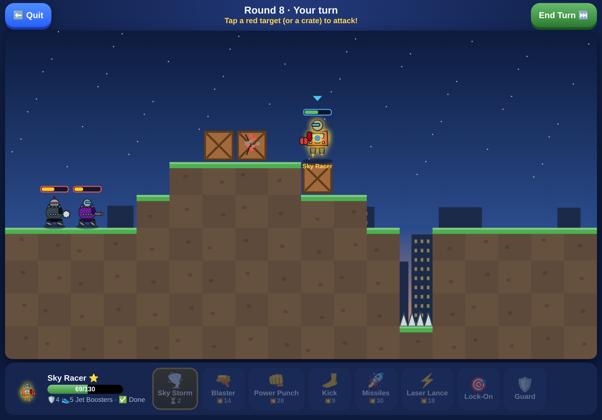
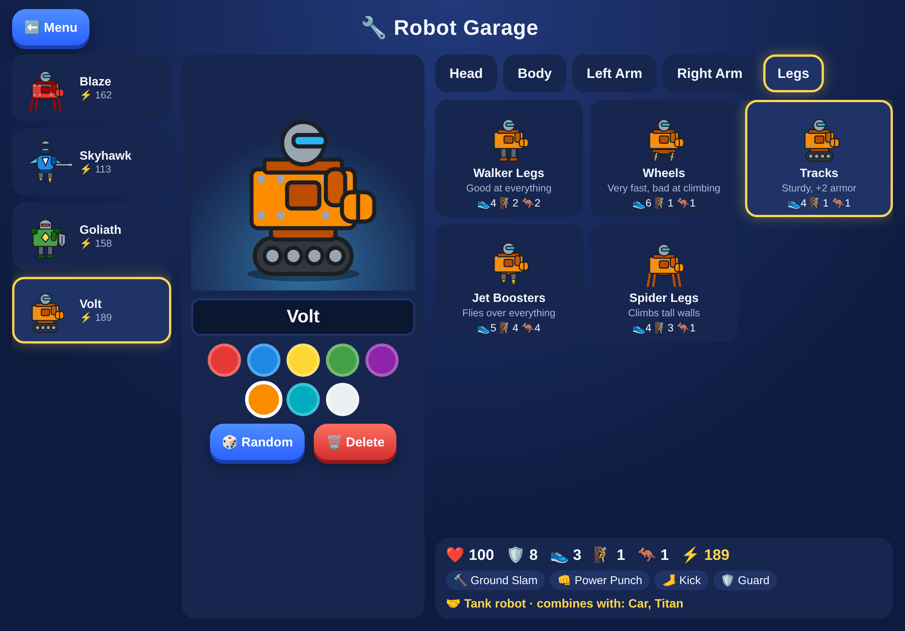
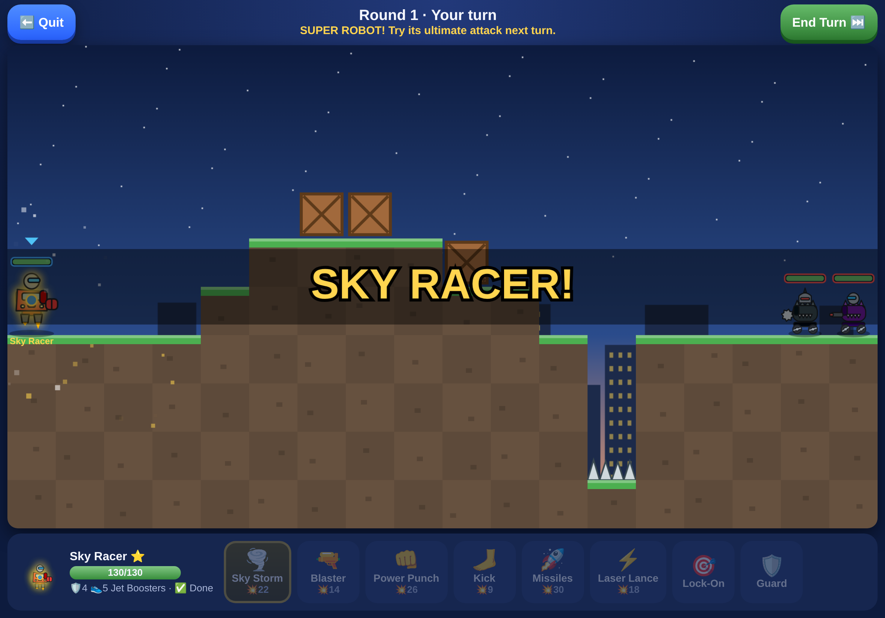
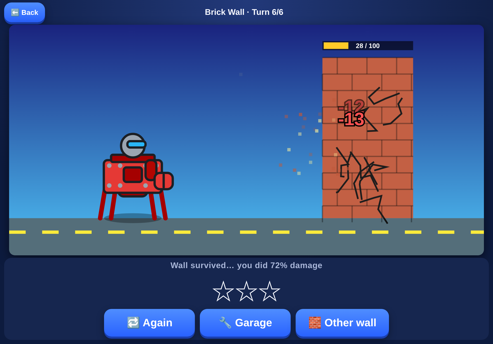

# 🤖 Strong Robots

A 2D browser game for kids who love Transformers and Tobots. It is built for iPad (landscape, touch) and also works on any desktop browser.

**▶ Play:** https://djezzzl.github.io/strong-robots/

On iPad, open the link in Safari and choose **Share → Add to Home Screen** to play full screen.



## What you can do

- **🔧 Garage.** Build up to 4 robots from parts: 5 heads, 5 bodies, 9 arm weapons (choose one for each arm), 5 kinds of legs, and 8 colors. Every part changes the robot's stats and gives it attacks or skills. Matching weapons on both arms become a *Double* attack.
- **🧱 Power Test.** Find out how strong your robot is. Smash a Brick Wall, Steel Wall, or Titanium Vault in 6 turns and earn up to 3 stars. Weapons that pierce armor work best on the hard walls.
- **⚔️ Battle.** Turn-based tactics on a side-view battlefield, in the style of Heroes 3 or XCOM. A new level is generated randomly every time, with Easy, Normal, and Hard modes. Robots walk, **climb**, **jump** over gaps, and **fall** down ledges, and each type of legs is good at different moves. Avoid the spikes and blow up crates so enemies fall off them.
- **🤝 Combine.** Two compatible robots standing next to each other can merge into a **super robot**. It gets more HP and every weapon from both robots, plus an ultimate attack. Not every pair matches:

| Cores | Super robot |
|-------|-------------|
| Car + Jet | Sky Racer 🌪️ |
| Beast + Titan | Mega Beast 🦁 |
| Tank + Titan | Iron Fortress 🏰 |
| Car + Tank | Road Crusher 🚚 |
| Beast + Jet | Dragon Knight 🐉 |
| Car + Jet + Titan | Omega Prime ☄️ |
| Beast + Tank + Titan | Giga Rex 🦖 |
| Beast + Car + Jet | Thunder Dragon 🌩️ |

The robot's body decides its core. On Hard, enemy robots can combine too!

| Garage | Combine | Power Test |
|---|---|---|
|  |  |  |

## Development

The game uses plain ES modules and Canvas 2D. It has no build step and no runtime dependencies.

```sh
npm install        # only needed for the browser smoke test
npm run dev        # http://localhost:8080
npm test           # unit tests (node --test)
npm run test:e2e   # Playwright smoke test as desktop + iPad (needs Chromium at /usr/bin/chromium or CHROME_PATH)
```

- `src/game/`: pure game logic (robots, combining, terrain and pathfinding, level generator, battle rules, AI, Power Test). It never touches the DOM.
- `src/render/`: canvas drawing, the battle animation queue, and sound effects.
- `src/ui/`: screens (menu, garage, setup, battle, Power Test).

Pushing to `main` deploys to GitHub Pages through `.github/workflows/pages.yml`. The design is described in [docs/superpowers/specs](docs/superpowers/specs/2026-11-18-strong-robots-design.md).
